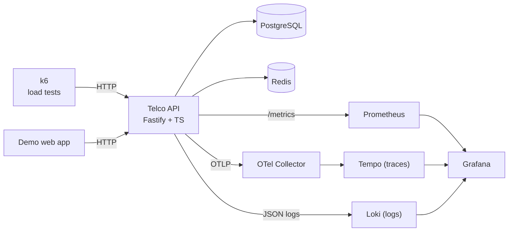

<div align="center">

# Performance & Reliability Testing Suite
### over the *Telco Reliability Lab* demo platform

A self-contained lab that load-tests, observes and **diagnoses** a realistic
telecom self-care platform (the fictional *Telco Reliability Lab* — the system
under test) — built to show how a QA Automation / SDET engineer thinks about
quality as engineering, not just as automated clicking.

[](https://github.com/fercarballo/performance-reliability-testing-suite/actions/workflows/ci.yml)
[](https://github.com/fercarballo/performance-reliability-testing-suite/actions/workflows/security.yml)
[](LICENSE)


</div>

---

## 📌 For recruiters & non-technical readers

Imagine a phone company's "My Account" app, where customers log in, check their
bills, change their plan and pay. If that app is **slow** or **breaks** near a
payment deadline, customers churn and support melts down.

This project builds a small but realistic version of that app **and** a complete
toolkit to answer the questions a quality engineer is actually paid to answer:

- How fast is each action, for the **slowest** users (not just the average)?
- At what traffic level does it start to break, and **which part breaks first**?
- When payments slow down, **can we find out why in minutes** instead of hours?
- Can the CI pipeline **block a release** that would make the app too slow?

It does this with industry-standard tools (k6, Prometheus, Grafana,
OpenTelemetry, Tempo, Loki), all runnable with a **single command**. The headline
skill it demonstrates: not just *running* tests, but **designing a reliability
strategy and diagnosing failures from evidence**.

> **The one-sentence version:** *"I designed and built a full performance &
> reliability suite over a telecom demo — risk-based SLOs, six load profiles,
> controlled fault injection, CI quality gates, and metric→trace→log correlation
> to diagnose incidents."*

---

## 🎯 What this project demonstrates

| Capability | How it shows up here |
|---|---|
| Performance testing with **k6** | Six distinct profiles (smoke, load, stress, spike, soak, degradation) |
| **SLO-driven** quality | Per-journey p95 / error-rate budgets enforced as code |
| **Reliability** testing | Controlled fault injection (latency / errors / timeouts), partial degradation |
| **Observability** | Prometheus metrics, OpenTelemetry traces (Tempo), structured logs (Loki) |
| **Incident diagnosis** | Full metric → trace → log correlation, worked end-to-end |
| **CI/CD quality gates** | Blocking smoke gate on GitHub Actions **and** GitLab CI |
| **Security at audit level** | CodeQL, secret scanning, dependency & image scans, no secrets in git |
| **Engineering hygiene** | TypeScript, unit tests, everything-as-code, reproducible via Docker |

---

## 🧠 The thinking (why it's built this way)

Most QA portfolios stop at "I automated some tests". This one is organised around
a thesis: **quality is an engineering discipline.** So the project is built in the
order a real quality strategy is built:

1. **Start from risk, not scripts.** Payments move money; login gates everything.
   That ranking drives the SLOs — see [docs/slo-definition.md](docs/slo-definition.md).
2. **Own the system under test.** A real Fastify/TypeScript API (not a public
   sandbox) so its failure modes can be controlled and instrumented.
3. **Match the test to the question.** Each load profile answers exactly one
   question — see [docs/performance-strategy.md](docs/performance-strategy.md).
4. **Make failure observable.** Inject faults on purpose and prove the stack can
   diagnose them — see [docs/incident-analysis-example.md](docs/incident-analysis-example.md).
5. **Gate releases on evidence.** Smoke is a blocking CI gate; exploratory tests
   produce evidence without blocking.

---

## 🏗️ Architecture



Full detail in [docs/architecture.md](docs/architecture.md).

---

## 🚀 Quickstart

**Prerequisites:** Docker + Docker Compose. (Node 22 only if you want to run unit
tests / regenerate data outside containers.)

```bash
# 1. Bring up the whole world (API, DB, cache, full observability stack)
docker compose up -d --build

# 2. Run the blocking quality gate
npm run k6:smoke          # or: docker compose run --rm k6 run /scripts/scenarios/smoke.js

# 3. Explore
open http://localhost:8080     # the demo self-care app
open http://localhost:3001     # Grafana dashboards (anonymous admin)
```

Then try the reliability story:

```bash
# Inject a payment latency fault and drive load through the degraded system
npm run k6:degradation
# Watch payment p95 spike on Grafana while login stays fast, then diagnose it.
```

| Open | At |
|---|---|
| Demo web app | http://localhost:8080 |
| Grafana (4 dashboards) | http://localhost:3001 |
| Prometheus | http://localhost:9090 |
| API | http://localhost:3000 |

---

## 🧪 The six test profiles

| Profile | Question | Gate | Command |
|---|---|---|---|
| **Smoke** | Healthy enough to continue? | ✅ blocking | `npm run k6:smoke` |
| **Load** | Meets SLOs under expected traffic? | ✅ SLO | `npm run k6:load` |
| **Stress** | Where does it break? | observe | `npm run k6:stress` |
| **Spike** | Survives & recovers from a surge? | observe | `npm run k6:spike` |
| **Soak** | Degrades over time? | ✅ SLO | `npm run k6:soak` |
| **Degradation** | Can we *diagnose* a fault? | observe | `npm run k6:degradation` |

Each run writes a JSON summary and an HTML report to `tests/k6/reports/`. Add the
`:prom` variant (`npm run k6:smoke:prom`) to feed the live k6 Grafana dashboard.

### What a passing smoke run looks like

```
✓ checks.........................: 100.00%  ✓ 1218  ✗ 0
✓ http_req_failed................: 0.00%
✓ { journey:login }..............: p(95)=7.3ms     (SLO < 600ms)
✓ { journey:payment }............: p(95)=31ms      (SLO < 1500ms)
  payment_idempotency_conflicts..: 87        (double-charges prevented)
```

---

## 🎯 Service Level Objectives

| Journey | p95 target | Error rate | Why |
|---|---:|---:|---|
| Login | < 600 ms | < 1% | Gates everything; must feel instant |
| Invoice lookup | < 800 ms | < 1% | Highest-volume read; DB + cache sensitive |
| Plan change | < 1200 ms | < 1.5% | Business logic + catalogue dependency |
| Payment | < 1500 ms | < 1% | Moves money — latency tolerant, error intolerant |

Defined and justified in [docs/slo-definition.md](docs/slo-definition.md), enforced
in [`tests/k6/helpers/thresholds.js`](tests/k6/helpers/thresholds.js).

---

## 🔍 The headline capability: incident diagnosis

A degradation test injects ~2 s latency into 30% of payments. The result, from a
real run:

| Signal | Healthy | During fault |
|---|---:|---:|
| Payment p95 | ~30 ms | **2.63 s** ❌ |
| Login p95 (unaffected) | ~10 ms | ~10 ms ✅ |
| Requests affected | 0 | **335** |

Then the investigation: a **metric** spike on a dashboard → a slow **trace** in
Tempo showing the time is in the `payment-gateway-simulator` span (database is
fine) → the **log** with the same `trace_id` confirming the cause. The full
walk-through is in [docs/incident-analysis-example.md](docs/incident-analysis-example.md).

---

## 📁 Project structure

```text
.
├── apps/
│   ├── api/                  # Fastify/TypeScript system under test
│   │   └── src/modules/      # auth, billing, plans, payments, faults, health
│   └── web/                  # static demo UI
├── tests/k6/
│   ├── scenarios/            # smoke, load, stress, spike, soak, degradation
│   ├── journeys/             # login, invoice-lookup, plan-change, payment
│   ├── helpers/              # thresholds, metrics, data, auth, summary
│   └── data/                 # synthetic CSVs (generated)
├── observability/
│   ├── prometheus/  grafana/  tempo/  loki/  otel-collector/
├── docs/                     # architecture, strategy, SLOs, incident analysis…
├── .github/workflows/        # CI + Security pipelines
├── .gitlab-ci.yml
└── docker-compose.yml
```

---

## ⚖️ Why this approach (pros & cons vs alternatives)

| Alternative approach | Pros | Cons | Why this project differs |
|---|---|---|---|
| **JMeter / Gatling** instead of k6 | Mature, GUI (JMeter) | Heavier, XML/Scala, less "tests-as-code" | k6 is JS, scenario-first, CI-native, with thresholds-as-code |
| **Cloud load service** (k6 Cloud, BlazeMeter) | Scales huge, hosted | Costs money, less transparent, not self-contained | Everything runs locally/CI, fully reproducible and free |
| **APM SaaS** (Datadog, New Relic) | Turnkey, powerful | Paid, vendor lock-in, hides the wiring | OSS stack shows I can *build* observability, not just buy it |
| **Test only the happy path** | Fast to write | Proves nothing about reliability | Fault injection + diagnosis is the actual differentiator |
| **One generic load script** | Simple | Answers no question well | Six purpose-built profiles, each with its own gate |
| **Click dashboards together** | Quick | Not reproducible, not reviewable | Dashboards/SLOs/datasources are all version-controlled code |

---

## 🔐 Security

Built to pass an audit for a public repo: **no secrets and no real data in git**,
least-privilege CI, and automated CodeQL / secret / dependency / image scanning.
Deliberate demo trade-offs (fast password hashing, the local-only fault-injection
endpoint) are documented, not hidden. See [SECURITY.md](SECURITY.md).

---

## 🗺️ Roadmap

- Alertmanager + error-budget burn-rate alerts
- Automatic run-over-run performance comparison in CI
- `kind` + k6-operator for distributed load
- OpenAPI contract tests and an OWASP ZAP baseline scan
- Executive Markdown reports per run

---

## 📚 Documentation

| Doc | What's inside |
|---|---|
| [architecture.md](docs/architecture.md) | Components, request lifecycle, design decisions |
| [performance-strategy.md](docs/performance-strategy.md) | The six profiles and why they're separate |
| [slo-definition.md](docs/slo-definition.md) | SLIs, SLOs, thresholds, justifications |
| [reliability-testing.md](docs/reliability-testing.md) | Fault injection model & safety rails |
| [observability-guide.md](docs/observability-guide.md) | How to use the metrics/traces/logs stack |
| [incident-analysis-example.md](docs/incident-analysis-example.md) | A worked incident, end to end |
| [interview-walkthrough.md](docs/interview-walkthrough.md) | 5–7 minute demo script |

---

<div align="center">
<sub>Built as a portfolio piece to demonstrate QA Automation / SDET / Quality Engineering practice. MIT licensed.</sub>
</div>
