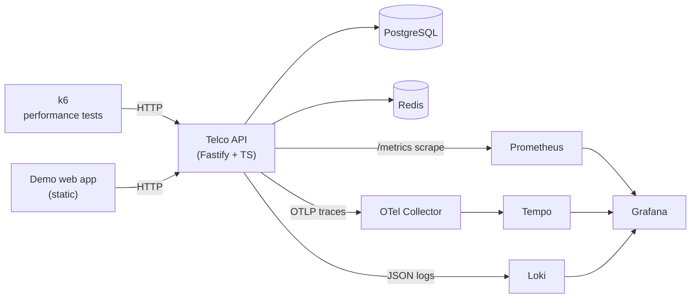

# Architecture

## The system in one picture

## Components and why each exists

| Component | Role | Why it is here (and not something simpler) |
|---|---|---|
| **Telco API** (Fastify/TypeScript) | System under test | A real, owned service — not a public sandbox — so we control its failure modes and can instrument it deeply. Fastify is chosen for low overhead, which matters when the whole project is about latency. |
| **PostgreSQL** | Transactional store | Invoice lookups and payments are real DB work; this is what saturates first under load. |
| **Redis** | Read-through cache | Makes invoice latency depend on cache state and cache health — a more interesting, more realistic load subject than a static endpoint. |
| **k6** | Load generator | Scenario-based, thresholds-as-code, scriptable journeys. The industry standard for code-first performance testing. |
| **Prometheus** | Metrics | Pull-based time series; the de-facto standard. Scrapes the API's RED + business metrics. |
| **OpenTelemetry Collector** | Telemetry ingestion | A single, vendor-neutral pipeline for traces. Sitting between app and backend means sampling/redaction/extra exporters can be added without touching the app. |
| **Tempo** | Traces | Stores distributed traces so a single slow request can be opened span-by-span. |
| **Loki** | Logs | Stores structured JSON logs, queryable and — crucially — correlated to traces by `trace_id`. |
| **Grafana** | Visualisation | One pane of glass over metrics, traces and logs, provisioned entirely as code. |

## Request lifecycle (what gets instrumented)

For a single `POST /payments` request:

1. **Metrics** — a Fastify `onResponse` hook records `http_requests_total`,
   `http_request_duration_seconds` and (on 5xx) `http_request_errors_total`,
   labelled by the route *template* to keep cardinality bounded. The payment
   handler also bumps `business_payments_total`.
2. **Trace** — OpenTelemetry auto-instrumentation creates a server span for the
   HTTP request and child spans for each `pg.query`. The payment service adds a
   manual `payment-gateway-simulator` span. All share one `trace_id`.
3. **Logs** — the handler emits a JSON log (`payment processed`) that carries
   the same `trace_id`, shipped to Loki.

That shared `trace_id` is the thread that ties the three signals together; the
[incident analysis](incident-analysis-example.md) walks the full path.

## Design decisions worth defending

- **Monorepo with npm workspaces.** One `docker compose up` brings up the whole
  world; one repo tells the whole story.
- **CommonJS build for the API.** Keeps the OpenTelemetry `--require`
  bootstrap and module patching simple and predictable.
- **Fault injection lives inside the app**, guarded to `local`/`ci` only. It is
  the engine of the reliability story, but it is a deliberate foot-gun and is
  never mounted in production (see [reliability-testing.md](reliability-testing.md)).
- **Synthetic data from one generator.** The same deterministic generator seeds
  the database and emits the k6 CSVs, so test data and stored data cannot drift.
- **Everything as code.** Dashboards, datasources, thresholds, SLOs and the
  whole environment are version-controlled. Nothing is clicked together by hand.

## Ports

| Service | URL |
|---|---|
| Telco API | http://localhost:3000 |
| Demo web app | http://localhost:8080 |
| Grafana | http://localhost:3001 |
| Prometheus | http://localhost:9090 |
| Tempo (API) | http://localhost:3200 |
| Loki (API) | http://localhost:3100 |
